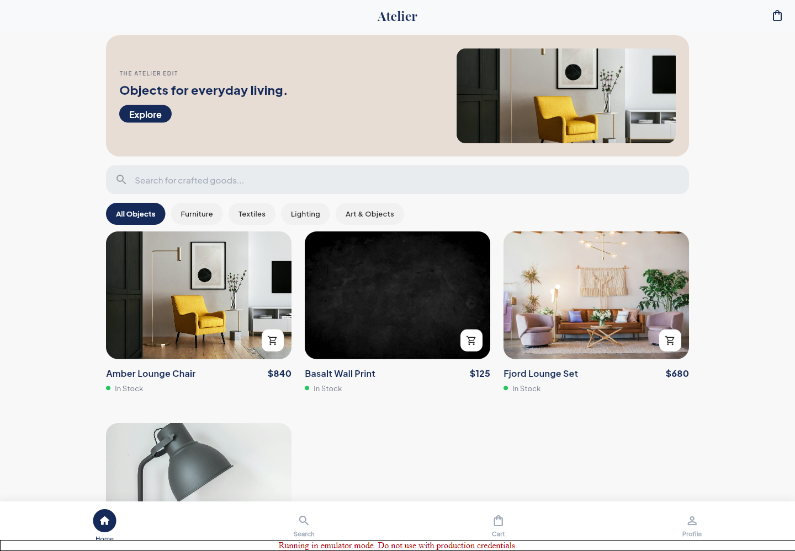
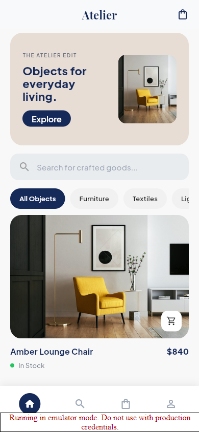
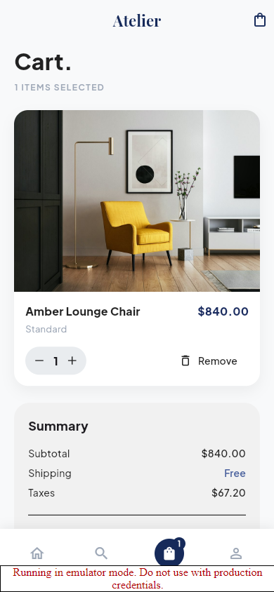
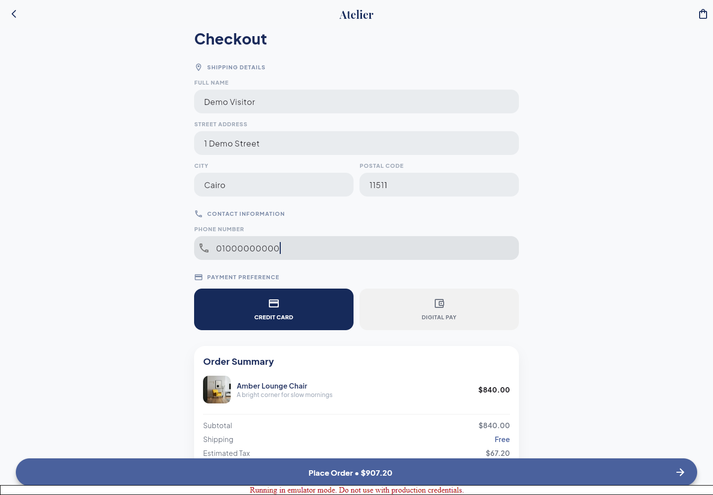
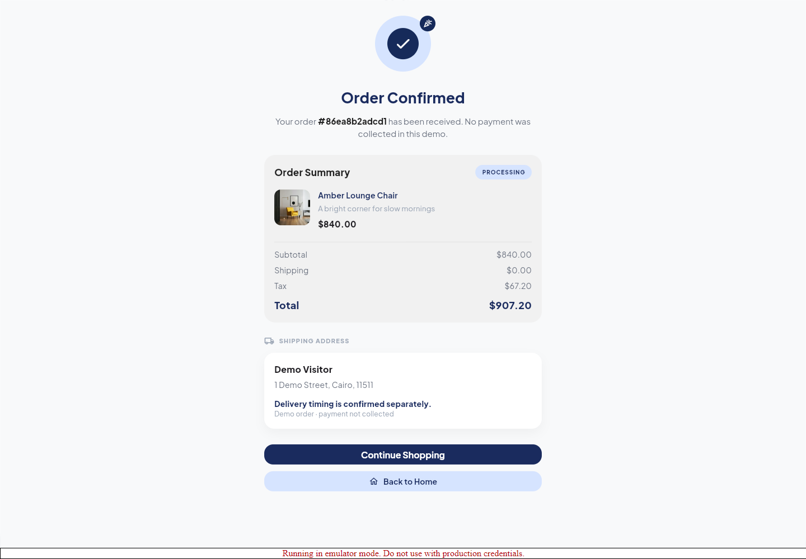
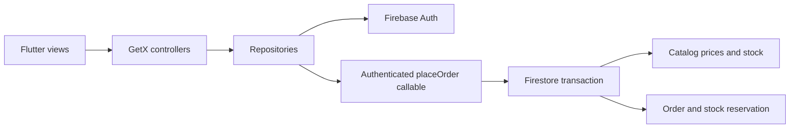

# Atelier · Flutter commerce with trusted checkout

[](https://github.com/Zyadashraf5/atelier-flutter-ecommerce/actions/workflows/ci.yml)

A home-decor storefront built with Flutter and Firebase. Browse a live catalog, select products, manage a cart and submit an order. An authenticated Cloud Function recalculates prices from the catalog and atomically reserves stock and saves the order.

**Portfolio scope:** a working commerce prototype with tested authorization and checkout logic. Checkout records an **unpaid** order; it does not charge a payment method. All screenshots use fictional data on local Firebase emulators.

## Screenshots

Real screenshots from the emulator build, including the responsive collection and a completed **unpaid demo order**.



| Mobile collection | Cart |
|:---:|:---:|
|  |  |

<details>
<summary>Checkout and server-confirmed order</summary>




</details>

## What you can review

- **Mobile and wide layouts:** product catalog, search, product detail, cart, checkout and account screens.
- **Feature-first Flutter:** GetX bindings and controllers, repository boundaries and one client-side pricing policy for the displayed estimate.
- **Server-owned pricing:** the app sends product ids, quantities and shipping details, never an authoritative price, user id or order status.
- **Atomic checkout:** stock is checked and decremented in the same Firestore transaction that creates the order. Concurrent shoppers cannot both buy the last item.
- **Safe retries:** a user-scoped request id returns the same order without decrementing stock twice. Reusing a key with a different payload is rejected.
- **Read-only client catalog:** only trusted administrative tooling can write products or categories. Customers can read their own orders and profiles.

## Architecture



```text
lib/core/          theme, responsive helpers, pricing estimate, session storage
lib/data/          models and repositories
lib/features/      screen-specific bindings, controllers and widgets
functions/         trusted checkout, validation, unit and integration tests
firestore-tests/   authorization tests against the Firestore emulator
```

Money is calculated in integer cents on the server. The confirmation screen uses the amounts and line descriptions returned by the server, including when catalog prices have changed since the cart was opened. Tax is a demo policy of 8%; shipping is free.

## Run locally without production credentials

Prerequisites: Flutter stable (tested with 3.47.9), Node 22, Java 21, and Python only if you choose to serve a release web build yourself.

```bash
git clone https://github.com/Zyadashraf5/atelier-flutter-ecommerce.git
cd atelier-flutter-ecommerce
flutter pub get
npm --prefix functions ci
npm --prefix firestore-tests ci
```

Start the emulators in one terminal:

```bash
firestore-tests/node_modules/.bin/firebase emulators:start --only auth,firestore,functions --project demo-atelier
```

On Windows, use `firestore-tests/node_modules/.bin/firebase.cmd`.

In a second terminal, seed fictional products and a demo shopper. Bash:

```bash
GCLOUD_PROJECT=demo-atelier FIRESTORE_EMULATOR_HOST=127.0.0.1:8080 FIREBASE_AUTH_EMULATOR_HOST=127.0.0.1:9099 npm --prefix functions run seed:demo
```

PowerShell:

```powershell
$env:GCLOUD_PROJECT = 'demo-atelier'
$env:FIRESTORE_EMULATOR_HOST = '127.0.0.1:8080'
$env:FIREBASE_AUTH_EMULATOR_HOST = '127.0.0.1:9099'
npm --prefix functions run seed:demo
```

Then:

```bash
flutter run -d chrome --dart-define-from-file=firebase.demo.json
```

Public demo credentials: **demo@example.com / demo-only-password**. These are fictional emulator credentials, not production access. The seed tool refuses real project ids and non-loopback emulator hosts. Emulator routing in the app is opt-in and requires a `demo-` project id. No real project identifiers are included.

## Tests

```bash
flutter analyze
flutter test
npm --prefix functions test
firestore-tests/node_modules/.bin/firebase emulators:exec --only auth,firestore,functions --project demo-atelier "npm --prefix functions run test:integration && npm --prefix firestore-tests test"
```

| Suite | Coverage |
|---|---|
| Flutter · 10 tests | Cart merging and quantities, tax/shipping rounding, app startup |
| Checkout unit · 15 tests | Forged totals and user ids, malformed quantities, missing products, stock aggregated across variants, money and retry identities |
| Checkout integration · 8 tests | Real Firestore transactions, retries, concurrent stock contention, rollback, anonymous rejection and authenticated HTTP callable |
| Firestore rules · 11 tests | Direct order writes denied, catalog create/update/delete denied, private orders and profiles, privileged profile fields denied |

CI runs all suites, strict Flutter analysis and a release web compilation. No production Firebase project is needed for CI.

## Connecting your own Firebase project

Register your apps, enable Email/Password sign-in, and fill an ignored `firebase.env.json` from `firebase.env.example.json`. Supply `google-services.json` locally for Android. Deploy the reviewed rules and `placeOrder` function together using your own project configuration. Populate the catalog through trusted administrative tooling; shoppers can no longer seed it.

Never deploy the demo project or use demo credentials in production. This repository does not change or deploy the original application's Firebase services.

## Production work still required

- Integrate a real payment provider and verified payment webhooks before marking anything paid.
- Add reservation expiry/cancellation and corresponding stock release; current orders reserve stock immediately.
- Configure App Check, operational quotas, monitoring and a reviewed tax/shipping policy for the target market.
- Social sign-in and some profile-menu actions remain placeholders. Only the email/password authentication flow is implemented.
- Android/iOS native builds and real-device behavior require their platform toolchains and your Firebase registrations.
- Demo photos are loaded from external Unsplash URLs; the app is not a fully offline storefront.

## Author

**Zyad Ashraf** · Flutter developer · [LinkedIn](https://www.linkedin.com/in/zyad-ashraf-flutter) · [Upwork](https://www.upwork.com/freelancers/~01f783ee63786311ea)

On Windows, Flutter may require Developer Mode for native plugin symlinks. No real payments or production-service access are needed for the local web demonstration.
